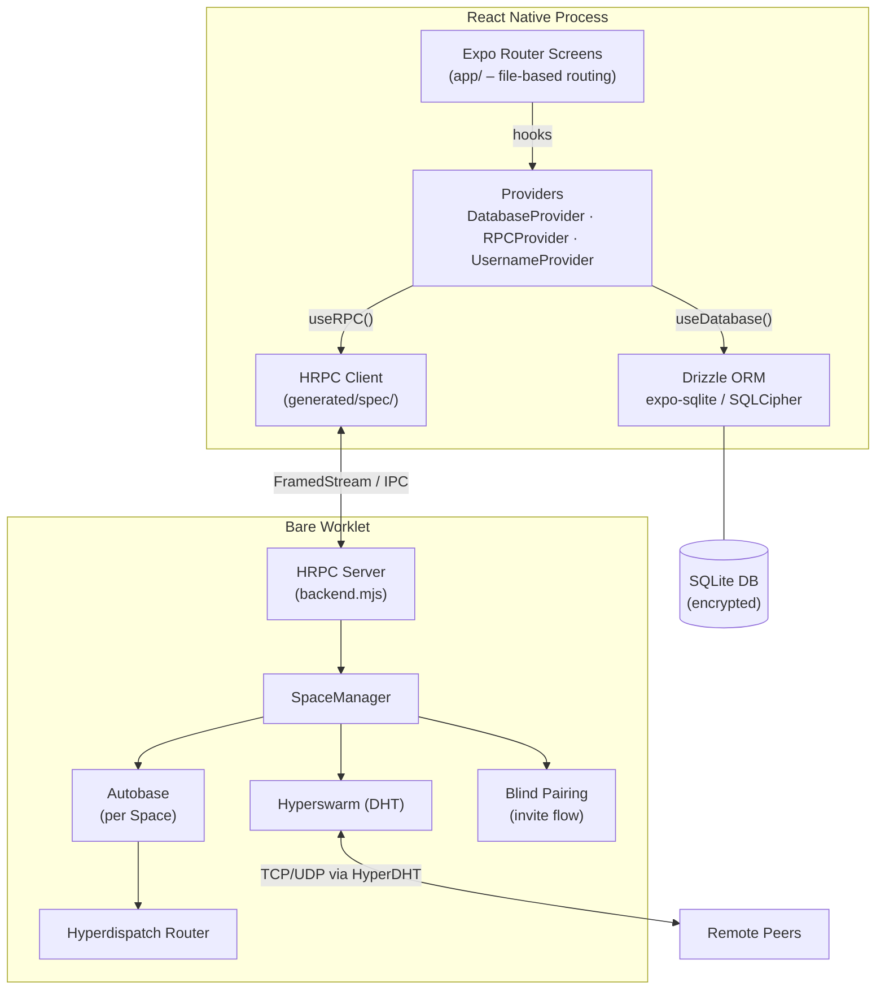

# Copilot Instructions - Personal Finance P2P App

## Project Overview
React Native (0.81.5) + Expo (SDK 54) personal finance app with P2P networking via Bare/Holepunch. Local-first architecture with encrypted SQLite storage and P2P sync via Hyperswarm/Autobase (working).

**Repository**: https://github.com/helloplayer1/master-thesis

## Architecture

### Dual Runtime Model
- **React Native (UI)**: Main app UI, database queries via Drizzle ORM, spawns Bare worklets
- **Bare Runtime (Background)**: Runs as worklet for P2P networking and heavy operations
- **IPC**: Communication via HRPC (schema-driven RPC) between React Native and Bare
  - Schemas defined in [builder/builder.js](application/builder/builder.js) → generates to `generated/spec/`
  - Backend code at [backend/backend.mjs](application/backend/backend.mjs) runs in Bare worklet
  - Backend bundled via `npm run pack:backend` (bare-pack) to `generated/app.bundle.js`

### Architecture Overview



### Database Layer
- **ORM**: Drizzle ORM with expo-sqlite + SQLCipher encryption
- **Schema Location**: [db/schema/](application/db/schema/) - 7 entities (account, transaction, category, tag, memberTag, space, spaceMember) + 2 join tables (transactionTag, transactionSpace)
- **Access Pattern**: ALWAYS use Drizzle instance from `useDatabase()` hook - raw SQLite DB is internal
- **Provider Pattern**: [db/db-provider.tsx](application/db/db-provider.tsx) uses React Suspense for async init, handles migrations automatically on app start
- **Migrations**: Run `npx drizzle-kit generate` after schema changes, apply via expo-sqlite/migrator in provider

### Domain Model
See [Requirements analysis for p2p.md](resources/Requirement%20analysis/Requirements%20analysis%20for%20p2p.md) for full requirements.

**Entities** (all with timestamps):
- **Account**: Financial accounts (type: checking/savings/credit/investment, balance, currency)
- **Transaction**: Income/expense with FK to Account (cascade delete), optional FK to Category (set null delete); includes a stored generated `signedAmount` column; `originPeerId` tracks the creator peer; `currency` defaults to `'EUR'`
- **Category**: Flat (no hierarchy); `id` is a slug that serves as the display name (e.g. `'groceries'`); has optional `icon` and `color`; `originPeerId` tracks the creator peer
- **Tag**: Simple labels for transactions; `id` is a slug (PK); has a separate `name: text NOT NULL` display field and an optional `color` field
- **MemberTag**: Tracks which external peers have active shared transactions referencing each tag (deletion gating)
- **Space**: Collaboration contexts for P2P sharing; `membershipStatus` is owner/member/pending
- **SpaceMember**: Tracks peers within a Space (peerId, role: owner/member, joinedAt)

**Relationships**:
- Transaction → Account (many-to-one, cascade delete)
- Transaction → Category (many-to-one, nullable)
- Transaction ↔ Tag (many-to-many via transactionTag)
- Transaction ↔ Space (many-to-many via transactionSpace)

### P2P Networking (Implemented)
- **Tech Stack**: Pear/Bare + Holepunch ecosystem (Autobase, Hyperdispatch, Hyperswarm)
- **Space Architecture**: Each Space = one Autobase instance (multiwriter data structure)
  - Autobase linearizes operations from multiple writers into eventually consistent order
  - Supports automatic reordering and checkpointing for consistency
- **Operations Layer**: Hyperdispatch manages operations sent over Autobase
  - Defines type-safe operations/commands for financial data (transactions, categories, budgets)
  - Router pattern for dispatching messages to handlers
- **Pairing**: Blind-pairing for secure Space invitation/joining (implemented)
  - Cryptographic blind pairing via HyperDHT; also supports QR code + deep link invites
  - Member creates invite → Candidate requests pairing → Member confirms → Candidate joins
- **Sync Strategy**: Autobase for automatic offline sync - peers fetch only new data when reconnecting
- **Member tracking**: SpaceMembers announced on join; member list visible in Space detail view
- **Services**: [services/p2p-provider.tsx](application/services/p2p-provider.tsx), [services/P2PBridge.tsx](application/services/P2PBridge.tsx), [services/auth-provider.tsx](application/services/auth-provider.tsx)

#### Supported P2P Operations

**Hyperdispatch operations** — propagated over Autobase to all Space peers:

| Operation | Description |
|---|---|
| `space-metadata` | Broadcasts Space name and owner username on creation |
| `add-writer` | Adds a new peer as a writable Autobase writer |
| `announce-member` | Announces a peer joining; creates a `SpaceMember` record on all peers |
| `share-transaction` | Shares a local transaction into the Space (visible to all members) |
| `unshare-transaction` | Removes a transaction from the Space |
| `update-transaction` | Updates amount, category, description, date, or notes of a shared transaction |
| `add-category` | Propagates a new category to all peers |
| `update-category` | Updates a category's icon or color on all peers |

**HRPC commands** — IPC between React Native and the Bare worklet:

| Direction | Command | Description |
|---|---|---|
| RN → Bare | `setupPassword` | First-run: generates blind key, hashes password, returns encrypted credentials |
| RN → Bare | `unlockWithPassword` | Decrypts blind key using password hash, sets session key |
| RN → Bare | `unlockWithCredentials` | Decrypts blind key using pre-hashed credentials (biometric path) |
| RN → Bare | `changePassword` | Verifies old password, re-encrypts blind key with new password, rotates all space keys |
| RN → Bare | `createSpace` | Creates a new Space and Autobase instance |
| RN → Bare | `openSpace` / `closeSpace` | Opens/closes the Autobase and Hyperswarm connection for a Space |
| RN → Bare | `createSpaceInvite` | Generates a blind-pairing invite code |
| RN → Bare | `joinSpaceViaPairing` | Initiates joining using an invite code |
| RN → Bare | `finalizeJoin` | Completes the join after pairing is confirmed |
| RN → Bare | `appendSpaceMetadata` | Writes space-metadata op to Autobase |
| RN → Bare | `appendMemberAnnouncement` | Writes announce-member op to Autobase |
| RN → Bare | `appendShareTransaction` | Writes share-transaction op to Autobase |
| RN → Bare | `appendUnshareTransaction` | Writes unshare-transaction op to Autobase |
| RN → Bare | `appendUpdateTransaction` | Writes update-transaction op to Autobase |
| Bare → RN | `backendReady` | Signals the worklet is initialised |
| Bare → RN | `updateSpaceMetadata` | Delivers received space-metadata to RN for DB write |
| Bare → RN | `updateMemberAnnouncement` | Delivers a peer's member announcement to RN for DB write |
| Bare → RN | `syncShareTransaction` | Delivers a received shared transaction to RN for DB write |
| Bare → RN | `syncUnshareTransaction` | Delivers a received unshare to RN to remove from DB |
| Bare → RN | `syncUpdateTransaction` | Delivers a received update to RN for DB write |

## Development Workflows

### Build & Run
```powershell
# Install dependencies
npm install

# Run on Android (recommended for development)
npm run android

# Run on iOS
npm run ios

# Generate HRPC schema (after modifying builder/builder.js)
npm run build-schema

# Bundle backend for Bare runtime (auto-runs on Metro start, or manually)
npm run pack:backend
```

### Database Workflows
```powershell
# Generate migration after schema changes
npx drizzle-kit generate

# Migrations apply automatically on app start via DatabaseProvider
```

### Adding HRPC Methods
1. Define request/response schemas in [builder/builder.js](application/builder/builder.js) via `schemaNs.register()`
2. Register RPC command via `ns.register()` with request/response types
3. Run `npm run build-schema` to generate TypeScript types
4. Implement handler in [backend/backend.mjs](application/backend/backend.mjs) using `rpc.onMethodName()`
5. Call from React Native via `const { rpc } = useRPC()` then `rpc?.methodName()` (see [app/_layout.tsx](application/app/_layout.tsx) for provider setup)

## Code Conventions

### UI Development
- **Design Philosophy**: Prioritize clarity, ease of use, and maintainability over visual complexity
- **Target**: Build a functional MVP with intuitive UX - defer polish and animations
- **Component Structure**: Keep components small, focused, and colocated with related code
- **Styling**: Use React Native's StyleSheet API - avoid inline styles, keep styles at bottom of file
- **Navigation**: Expo Router file-based routing (`app/` directory structure maps to screens)
- **Forms**: Use controlled components with clear validation feedback; prefer simple text inputs over complex pickers
- **Reusability**: Extract repeated UI patterns into `components/` folder only after 3rd use
- **Accessibility**: Always provide meaningful labels, test with screen readers, ensure sufficient contrast
- **No UI Libraries**: Avoid heavyweight UI frameworks (NativeBase, React Native Paper) - build with primitives for full control

### UI Layout Principles
- **Card-based grouping**: Group related information in cards with subtle shadows on light backgrounds for visual separation
- **Horizontal layouts for data**: Use inline key-value pairs (label on left, value on right) with dividers between rows for compact, scannable displays
- **Conditional visibility**: Only render sections when they contain data - hide empty states unless placeholder text adds value
- **Compact spacing**: Minimize vertical whitespace - keep related information close together for easier scanning
- **Clear hierarchy**: Use font size, weight, and color to establish visual hierarchy without excessive spacing
- **Inline editing**: When toggling to edit mode, replace text with inline inputs on the same row rather than stacking full-width inputs below labels

### UI Patterns
```tsx
// Screen layout with safe areas
import { SafeAreaView } from 'react-native-safe-area-context';

function TransactionsScreen() {
  return (
    <SafeAreaView style={styles.container}>
      <View style={styles.content}>
        {/* Screen content */}
      </View>
    </SafeAreaView>
  );
}

const styles = StyleSheet.create({
  container: { flex: 1, backgroundColor: '#fff' },
  content: { flex: 1, padding: 16 },
});
```

### TypeScript Patterns
- **Strict mode enabled** - all code must be fully typed
- **Path alias**: Use `@/*` for absolute imports (e.g., `import { db } from '@/db'`)
- **Schema types**: Export via `$inferSelect` and `$inferInsert` from Drizzle schemas

### Database Queries
```typescript
// ALWAYS get db from hook, never import raw SQLite
const db = useDatabase();

// Prefer query syntax (relational) over SQL-like syntax - cleaner and supports nested relations
const accounts = await db.query.accounts.findMany({
  where: eq(schema.accounts.userId, userId),
});

// For reactivity with relational queries, use useLiveRelationalQuery (has bug fixes over default)
// Import from @/drizzleLiveQueryExtension/liveRelationQueryHook
import { useLiveRelationalQuery } from '@/drizzleLiveQueryExtension/liveRelationQueryHook';

const { data } = useLiveRelationalQuery(
  db.query.transactions.findMany({
    with: {
      category: true,
      account: true,
    }
  }),
  [schema.transactions, schema.categories, schema.accounts]
);

// SQL-like syntax still works but is more verbose
// const accounts = await db.select().from(schema.accounts).where(eq(schema.accounts.userId, userId));
```

### Component Patterns
- **Suspense + ErrorBoundary**: Wrap async providers (see [app/_layout.tsx](application/app/_layout.tsx))
  ```tsx
  <RPCProvider>
    <AuthProvider>
      <UsernameProvider>
        <AppAuth />
      </UsernameProvider>
    </AuthProvider>
  </RPCProvider>
  ```
- **RPC Access**: Use the `useRPC()` hook from `@/backend/rpc-provider` — `RPCProvider` manages the Bare worklet lifecycle and all P2P service initialization:
  ```tsx
  import { useRPC } from '@/backend/rpc-provider';

  const { rpc } = useRPC();
  // rpc may be null until the worklet is ready
  await rpc?.someMethod({ ... });
  ```
- **List Rendering**: Use `FlatList` for performance, avoid `ScrollView` with `.map()` for large lists
  ```tsx
  <FlatList
    data={transactions}
    keyExtractor={(item) => item.id}
    renderItem={({ item }) => <TransactionItem transaction={item} />}
    ListEmptyComponent={<Text>No transactions yet</Text>}
  />
  ```
- **Forms**: Simple controlled inputs with local state, validate on submit
  ```tsx
  const [amount, setAmount] = useState('');
  const [error, setError] = useState('');
  
  const handleSubmit = () => {
    const parsed = parseFloat(amount);
    if (isNaN(parsed) || parsed <= 0) {
      setError('Enter a valid amount');
      return;
    }
    // Process form...
  };
  ```

### Schema Changes
1. Modify files in [db/schema/](application/db/schema/)
2. Update [db/schema/index.ts](application/db/schema/index.ts) if adding new files
3. Run `npx drizzle-kit generate` to create migration SQL
4. Migrations auto-apply via `useMigrations()` in [db/db-provider.tsx](application/db/db-provider.tsx)
5. Verify migration in [drizzle/](application/drizzle/) directory

## Critical Files
- [db/db-provider.tsx](application/db/db-provider.tsx) - Singleton DB provider with Suspense/ErrorBoundary
- [db/schema/index.ts](application/db/schema/index.ts) - Central schema export
- [builder/builder.js](application/builder/builder.js) - HRPC schema definitions
- [backend/backend.mjs](application/backend/backend.mjs) - Bare runtime RPC handlers
- [backend/rpc-provider.tsx](application/backend/rpc-provider.tsx) - RPCProvider context + `useRPC()` hook; manages worklet lifecycle and P2P service init
- [services/auth-provider.tsx](application/services/auth-provider.tsx) - AuthProvider context + `useAuth()` hook; manages auth lifecycle and password/biometric flows
- [services/p2p-provider.tsx](application/services/p2p-provider.tsx) - P2PProvider context + `useP2P()` hook; space and transaction sharing operations
- [services/P2PBridge.tsx](application/services/P2PBridge.tsx) - Bridges RPC and DB into P2PProvider
- [services/username-provider.tsx](application/services/username-provider.tsx) - UsernameProvider context
- [app/_layout.tsx](application/app/_layout.tsx) - Root layout; nests RPCProvider → AuthProvider → UsernameProvider → AppAuth
- [metro.config.js](application/metro.config.js) - Hooks bare-pack on bundle, adds `.sql` support
- [drizzle.config.ts](application/drizzle.config.ts) - Migration config

## Security Notes
- DB encryption key is derived from the user's password via Argon2id (in the Bare worklet) and passed to SQLCipher as a raw hex key — no hardcoded passwords
- Foreign keys enforced via `PRAGMA foreign_keys = ON`
- SQLCipher encryption active for all data at rest

## Common Gotchas
- Metro auto-runs `npm run pack:backend` on first bundle (see [metro.config.js](application/metro.config.js))
- Raw SQLite DB is internal - NEVER bypass Drizzle ORM
- Timestamp fields use integer mode with `unixepoch()` default
- `categories.id` is the slug/display name (e.g. `'groceries'`) — no separate `name` column, no `parentId`, no `type`
